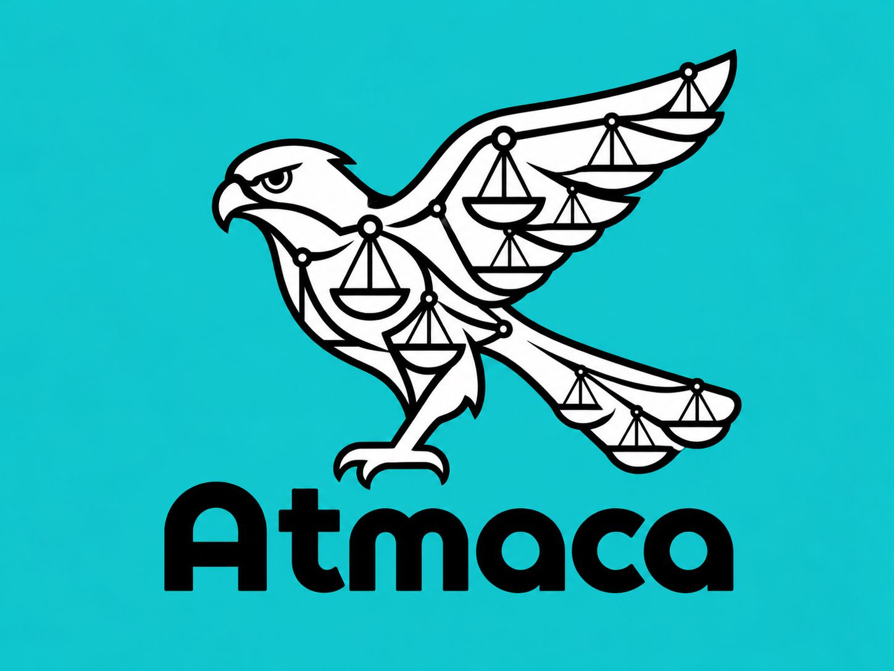
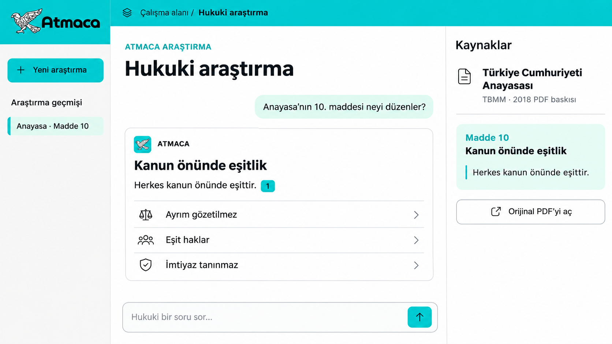

# Eren Senegör

### Founder of ATMACA · AI Product Builder · Entrepreneur

**Building practical AI products that make complex work simpler.**

---

## About me

I'm **Eren Senegör**, an entrepreneur building **ATMACA** — an AI-powered legal research workspace focused on helping legal professionals work with source-linked information.

I care about useful products, thoughtful interfaces, trustworthy AI, and turning ideas into software people can actually use.

- **Currently building:** ATMACA
- **Interested in:** AI agents, legal technology, product design, and startups
- **Approach:** Build, test, learn, improve

## Featured project · ATMACA

> **Legal research, with the evidence in view.**

ATMACA aims to bring case facts, relevant decisions, legislation, source passages, and working notes into a single research trail. The goal is to make findings easier to inspect, verify, and build upon.

| Source-linked research | Organized case work |
| :--- | :--- |
| Explore decisions and provisions alongside supporting passages. | Keep sources, comparisons, and working notes together. |

  
   
  ATMACA research workspace · design concept

 

  
   
  From a legal question to a traceable research trail · design concept

  <a href="https://atmaca-chat.vercel.app"><strong>Explore ATMACA</strong></a>

---

## Areas I'm exploring

## GitHub activity

Statistics are provided by a third-party service and may be unavailable or incomplete, especially for private repositories.

---

### Let's build something meaningful.

Interested in AI, startups, or the future of legal technology?

**Think bigger. Build smarter.**

